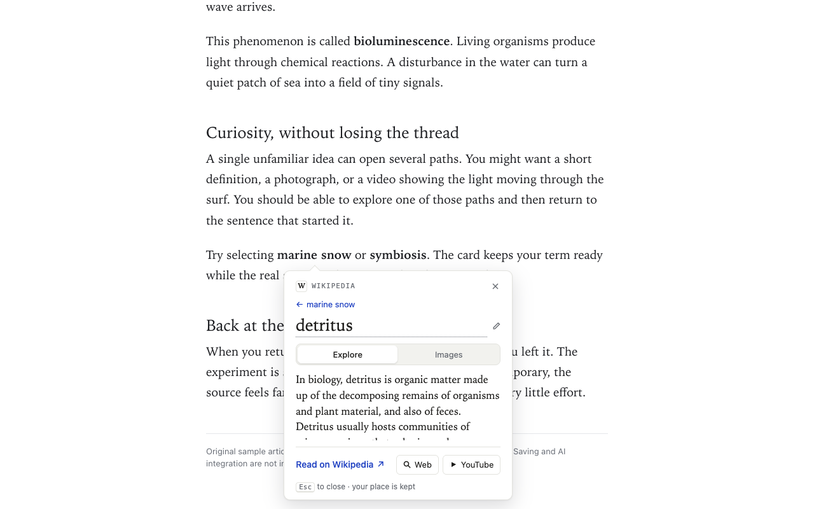
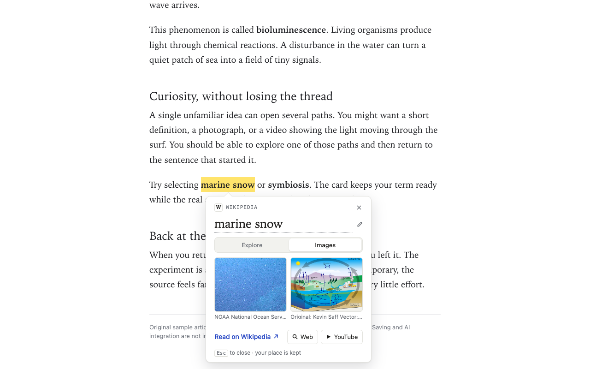
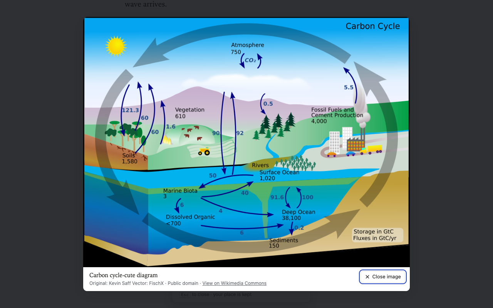
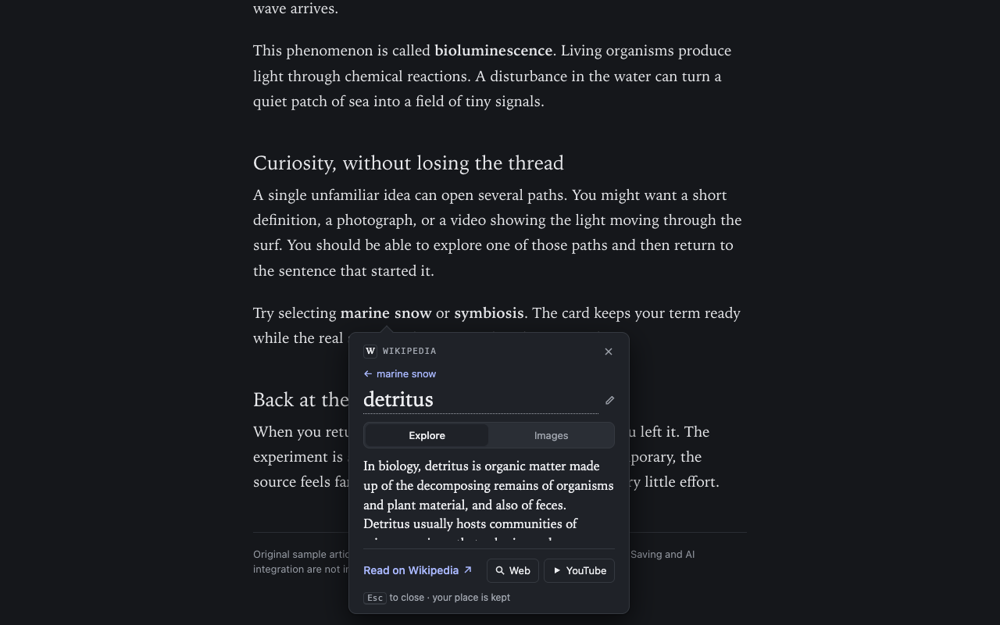

# Curious

Select a word or phrase on a web page, click **Learn more**, and a small note opens right beside it: a short Wikipedia definition, pictures from Wikimedia Commons, and one-click Web and YouTube searches in a compact window. Close the note and you are exactly where you left off.

Curious is a browser extension for Chrome, Brave and Safari. It is an early prototype (version 0.0.12), shared openly as it develops.



## What it does

- **Learn more beside your selection.** Select text and a Learn more button appears just after it, or press Option+L (Alt+L on Windows and Linux). The note opens below the text, or above it near the bottom of the window.
- **Explore.** The first two sentences of the matching English Wikipedia article, with its title, a link to the full article and the CC BY-SA 4.0 attribution. The term is an editable headline, so you can refine it in place.
- **Images.** Up to six pictures from that article's own media, each with its author, license and a link to its Commons file page. Click one to enlarge it over the page.
- **Follow-up lookups.** Select a word inside the definition and choose Look up to explore it in the same note. A Back link steps through the terms you visited.
- **Web and YouTube.** Each opens a small separate window. Chrome and Brave use your browser's default search engine; Safari asks you to pick a provider once in the extension's settings. Close the window to return to your article.
- **Light and dark.** The note follows your system appearance. Escape closes it.
- **Per page, or always on a site.** Clicking the toolbar button turns Curious on for the page you are on. Right-click the button and choose **Always on this site** or **On all sites** to have it load by itself; the browser asks you first. **Stop on this site**, **Stop on all sites** and the Sites list in settings turn it off again. The icon shows off, on for this page, or always on for this site.

| Images | Enlarged image | Dark mode |
| --- | --- | --- |
|  |  |  |

## Install (unpacked, for trying it out)

Curious is not in any extension store yet.

**Chrome or Brave**

1. Clone this repository.
2. Open `chrome://extensions` (or `brave://extensions`) and turn on Developer mode.
3. Click **Load unpacked** and choose `prototypes/compact-window/extension`.
4. On an article, click the Curious toolbar button to turn it on for that page, then select some text.

**Safari (macOS)**

1. Turn on Safari's developer features (Settings → Advanced → Show features for web developers).
2. In Settings → Developer, click **Add Temporary Extension…** and choose `prototypes/compact-window/safari-extension`.
3. Open the extension's settings once and choose a search provider.
4. Turn Curious on for a page with its toolbar button, then select some text.

After updating the files, reload the extension (and the page) so the browser picks up the new version.

**Standalone demo (no install)**

```sh
python3 -m http.server 8765 --bind 127.0.0.1 --directory prototypes/compact-window
```

Then open http://127.0.0.1:8765.

## Data use

- Only the term you look up is sent, and only to `https://en.wikipedia.org`, the extension's only required host permission. Requests leave out cookies and the page address.
- Pictures load from `upload.wikimedia.org` and `thumb.wikimedia.org` without cookies or referrer.
- Web and YouTube searches open the real sites in a normal browser window, under your existing browser session.
- Curious keeps no history and has no server or account. The only things it stores are your search-provider choice and the sites you chose, in the browser's extension storage.
- The extension runs only on pages you turn on with the toolbar button, and on sites you chose with Always on this site or On all sites. Installing it grants no website access; those choices ask the browser for access to that site (or all sites) when you make them, and the list of sites stays in the browser's extension storage on this device.

## Project layout

- `prototypes/compact-window/`: the card (`card.js`), Wikipedia adapter, demo pages, and the `extension` (Chrome/Brave) and `safari-extension` packages. `card.js` is kept byte-identical across all three.
- `docs/mvp-spec.md`: the product spec and user stories.
- `docs/qa/`: test records and screenshots for each version.

Apture was this project's early working name. It refers to a separate, earlier product and is not used in Curious; older notes in `docs/` still mention it.

## License

Code is released under the [MIT License](LICENSE). Definitions shown in the card come from Wikipedia under CC BY-SA 4.0, and pictures carry their own Wikimedia Commons licenses, credited in the card.
