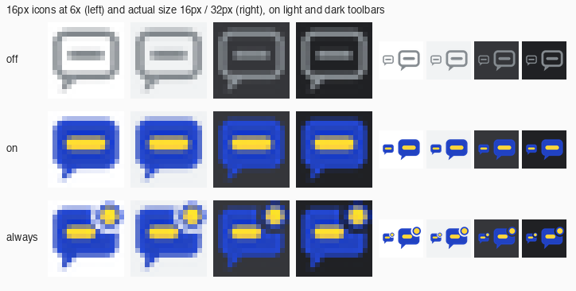
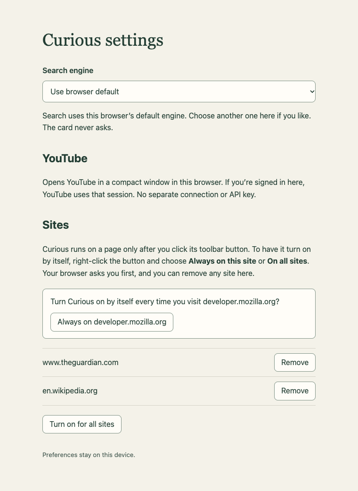

# Always on this site / On all sites (0.0.11, 2026-10-26)

## Update: 0.0.12 (2026-10-27), fixes from the owner's Safari hand check

**Found by the owner in Safari 27 on cnbc.com.** They had chosen Always on this site from the right-click menu (Settings > Sites lists www.cnbc.com) and answered Safari's prompt with Allow for One Day.

- **Defect 1 (withdrawn).** It was first reported that one-day access from a plain click made other cnbc.com pages load the card by themselves. With always-on chosen, that auto-loading is correct. No code path lets host access alone turn always-on on: only the menu's Always on this site / On all sites (after the browser grants) and the Settings buttons store a site or register a script, and permission events only prune. A scripted check confirms it (below). No behaviour was changed for it.
- **Defect 2 (fixed).** With cnbc.com always on and the card working, the icon showed off on an inner page and after Back to the homepage. Cause in 0.0.11: the icon was set at `loading` from storage plus a `permissions.contains` re-check, and set to off (pruning the site) whenever that check said no. Separately, Chrome reports `status: 'loading'` for `pushState`, hash changes and back/forward cache restores, and since 0.0.5 that reset the icon to off while the card stayed on the page. What Safari's `contains` answered there is not known.

**Fix (0.0.12).**
- The icon follows the card. At every `loading` and `complete` the worker checks the tab for the card, and `card.js` announces itself on start and on a back/forward cache restore (`pageshow`, `persisted`). The latest check per tab wins. "Always" requires both the card on the page and the reader's choice in Curious.
- A page load no longer erases a stored choice. When the browser's grant has lapsed (Allow for One Day), the card can't load, so the icon shows off. The menu offers Always on this site again. Settings shows the site as "(browser access ended, off for now)" with Allow again and Remove. The next sync (permission change or browser start) drops it if access is still gone.

`card.js` changed (the announcement only, byte-identical in all three places). Both manifests are 0.0.12.

**Scripted results, Chrome 156.0.8078.49** (Chrome updated itself between runs). Since Chrome 156, a toolbar click on an extension whose hosts are withheld no longer fires `action.onClicked`. So the per-page groups now load the **real, unmodified 0.0.12 package**, and the test copy (hosts withheld, then granted through Chrome's site-access controls) is used only for granted access.

| Suite | Result |
| --- | --- |
| Always-on suite, extended | **91/91** |
| Card regression (`run.js`) | 15/15 |
| Follow-up lookups and trail (`trail.js`) | 27/27 |
| Double-click, Escape focus, next-Tab (`nexttab.js`) | 27/27 |
| `node scripts/build-chrome-zip.mjs` | `dist/curious-chrome-0.0.12.zip`, 18 files |
| Safari app, `xcodebuild` Debug unsigned | builds; bundle has 0.0.12 `card.js` and `background.js` |

New checks:
- **Icon follows the card, always on** (Defect 2). On an always-on site: start, `pushState`, hash change, a same-site link to a new page (the card loads by itself) and Back from the back/forward cache all show "always" with the card present. On the restore, the card announced itself to the worker.
- **Icon follows the card, per page** (real package). The same journey after a click shows "on", off on the new page (card gone), and "on" again after Back restores the cached page with its card.
- **Plain-click grant never means always** (Defect 1, not reproduced). Site access granted the way Safari's click prompt grants it fires `permissions.onAdded`. The icon shows on, nothing is stored or registered, and the next page on that site gets no card.
- **Lapsed access.** A stored site whose grant is gone: no card, icon off. Settings shows "(browser access ended, off for now)" with Allow again and Remove. The next sync drops it.

**Not provable here (Safari).** Whether Safari reports `tabs.onUpdated` for back/forward restores (the card's `pageshow` announcement covers it either way). What `permissions.contains` answers during and after a one-day grant. Whether Safari, once a one-day grant lapses, asks again when the registered script wants to run.

### Safari re-check for 0.0.12 (short)

1. Rebuild and run the Curious app (or reload the temporary extension) and confirm 0.0.12. Settings > Sites should still list www.cnbc.com.
2. **Defect 2.** On cnbc.com, open an article: the card works by itself and the icon shows the corner dot. Open another article, then press Back to the homepage, then Forward, a few times. Expected: corner dot whenever the card works (selecting a word shows Learn more). Leave for another site and come back: same.
3. **Per page.** On a site you never chose, click the button: blue note, no dot. Follow a link on that site: gray icon, no card. Press Back: blue note if the card is still there, gray if not; never gray while Learn more works.
4. **One-day grant lapsing (tomorrow, or by setting cnbc.com to Ask/Deny in Safari Settings > Websites > Curious).** Expected: if Safari doesn't run the card, the icon is gray. Curious settings lists www.cnbc.com as "(browser access ended, off for now)" with Allow again (Safari asks again; choose Always Allow to avoid repeats) and Remove. If Safari instead asks again by itself when the page loads, note it.
5. Optional, to read stored state: Develop > Service Workers > Curious (click the Curious button first so its worker is running; Curious uses a service worker, so it isn't under Web Extension Background Content). In the console: `await chrome.storage.local.get(null)` and `await chrome.scripting.getRegisteredContentScripts()`.

---

**Change.** Curious can stay on for a site, or for all sites, if the reader asks. Default unchanged: installing grants no website access and a toolbar click turns Curious on for the current page only. Right-clicking the toolbar button offers **Always on this site** and **On all sites** (or **Stop on this site** / **Stop on all sites** once one applies). Each "on" choice asks through the browser's own permission prompt, for that page's origin only or for `http://*/*` + `https://*/*`; once granted, `card.js` is registered as a content script for those sites and loads with no click. Settings gains a Sites list with Remove for each site. The toolbar icon has a third state, always on for this site. Stop on all sites clears every site, including ones chosen one by one. Design and the reasons for the right-click menu are in [the prototype README](../../prototypes/compact-window/README.md#always-on-a-site-0011).

**Files.** `background.js` (both packages, identical), `settings.html` / `settings.js` (demo and both packages, identical), both `manifest.json` (0.0.11, `contextMenus`, `optional_host_permissions`), three new `icons/always-{16,32,48,128}.png` per package, `scripts/build-chrome-zip.mjs`. `card.js` is unchanged from 0.0.10 and byte-identical in all three places.

## Scripted checks, Chrome 155.0.8059.85 (headless, puppeteer-core 24.43.1, `pipe: true`, `enableExtensions`)

### What the automation does and does not cover

The browser's permission prompt can't be clicked in automation. So the always-on suite runs on a **test copy** whose manifest moves the two optional host patterns into `host_permissions`. At the start, Chrome's own site-access controls (the `chrome://extensions` page's `developerPrivate` API, which backs its Site access menu) withhold every host except en.wikipedia.org, so the copy starts with exactly the access a fresh 0.0.11 install has. "Accepting the prompt" is then simulated by granting one site, or all sites, through those same controls; "removing access in the browser" by revoking it there. These grants fire the same `permissions.onAdded` / `onRemoved` events and `permissions.contains` answers as the real prompt. A real click in Settings then calls `permissions.request`, which resolves `true` without a prompt because the access is already there.

Covered: everything after the reader accepts or removes access: storage, registration and re-registration, auto-load on reload and on new pages, other sites untouched, per-page toggling on an always-on site, Stop on this site, On all sites with a stopped site and Allow again, Stop on all sites, browser-side revocation, a grant that lapses without an event, a full browser restart, Settings rendering, tooltips, and menu item visibility. The toolbar clicks are real (`Extensions.triggerAction`, the same event a user's click fires), so they carry `activeTab` as a real click does.

Not covered by automation:
- **The prompt itself and a real right-click menu.** Chrome has no automation hook for the action's context menu. The menu handler was called directly from the worker, which has no user gesture, so the test exercises the fallback (Chrome refuses the request, Settings opens to ask). Separately, a probe extension confirmed that in Chrome 155 a toolbar event in the service worker does carry a user gesture to `permissions.request` (the prompt opened and stayed pending) while the same call without a gesture is refused. That a right-click menu click behaves the same is expected but not proven here.
- **`permissions.remove` actually removing optional access.** In the test copy the hosts are required, so Chrome refuses to remove them (`You cannot remove required permissions`); the code ignores that error, and the test revokes through Chrome's controls instead. That Brave's site-access details lose the site after Stop is a hand check below.
- Brave, Safari, page zoom, and the Web Store install dialog.

### Results

| Suite | Result |
| --- | --- |
| Always-on suite (new): install state, per-page default, Always on this site, Stop on this site, On all sites, browser removes access, lapsed access, restart | **71/71** |
| Card regression from 0.0.3 (`run.js`: anchoring, live definition, focus, search/YouTube windows, Escape, Option+L, edges, 400 px, dark) | **15/15** |
| Follow-up lookups and Back trail (`trail.js`, includes toolbar-off cleanup) | **27/27** |
| Double-click, Escape focus restoration and next-Tab (`nexttab.js`, fixture + GitHub-like page) | **27/27** |
| Install-time permissions shown by `chrome://extensions`, real manifests 0.0.10 vs 0.0.11 | identical: no permission messages; host access lists only `https://en.wikipedia.org/*`; granted origins at install `["https://en.wikipedia.org/*"]` |
| `node scripts/build-chrome-zip.mjs` | builds `dist/curious-chrome-0.0.11.zip`, 18 files |
| Safari app, `xcodebuild` Debug, unsigned | builds; the bundled `Curious Extension.appex` has manifest 0.0.11 (`contextMenus`, optional hosts) and all 12 icons. Not run in Safari. |

The build script needed three updates: it now expects `contextMenus` and the optional hosts and ships the `always-*` icons; its name check expected "Curious" although the manifest has been "Be Curious" since the store rename; and its Apture check matched `capture:true` in card.js. With those, it passes.

An independent code review of the worker and Settings found no race in the update queue and no way for a web page or content script to change site access (only extension pages may send `access` messages). It raised two medium items, both fixed before the final run: a grant that lapses without an event left the icon and menu claiming "always" (now re-checked on each load), and Stop on all sites could silently lose separately chosen sites in Chrome (now it clears them on purpose, in every browser).

The always-on suite, in groups:

- **Install.** Real manifest: only Wikipedia as a host permission; all-site access only in `optional_host_permissions`; no static `content_scripts`; `contextMenus`; version 0.0.11. Nothing registered or stored at install.
- **Per page (default).** No card before a click; tooltip "Turn on Curious for this page. Right-click for Always on this site."; click on (one card, "Curious is on for this page…"), click off, reload resets to off, Option/Alt+L inert while off.
- **Always on this site** (127.0.0.1). Menu without a gesture: request refused, Settings opens with "Always on http://127.0.0.1", nothing stored before access is granted. After granting and clicking it: the site is stored, `card.js` is registered for `http://127.0.0.1/*` only (`document_idle`, `persistAcrossSessions`), Settings lists it with Remove. Reload and a second page on the site load the card by themselves (one card each, tooltip "always on"). localhost (another site) gets no card. Two extra `executeScript` injections on top of the registered one still leave one card. Toolbar click turns that page off ("…comes back on the next page") without changing the site; clicking again brings back exactly one card. On the auto-loaded card: Learn more beside a selection, live definition, resize to 640×400 keeps the card inside the window, back to 1280×800 beside the word, Escape closes, double-click offers Learn more. Menu shows Stop on this site there and Always on this site on localhost.
- **Stop on this site.** Site removed from storage and registration, cards taken off both open tabs of the site, tooltips off, Settings list empty; reload: no card; per-page click still works.
- **On all sites.** With 127.0.0.1 already chosen on its own, Turn on for all sites in Settings: stored, registered for `http://*/*` and `https://*/*`, Settings shows All websites and the chosen site. Both sites load the card. Stop on this site on localhost while all sites are on: stored as skipped, `excludeMatches: ["http://localhost/*"]`, card removed there only; Settings shows "Not on http://localhost" with Allow again, which clears it. Stop on all sites: the separately chosen site is cleared too, nothing registered, cards removed from both sites, tooltips off, Settings back to the empty state.
- **Browser removes access.** Always on this site from the menu path puts the card on the current tab at once. Revoking the site in Chrome's controls drops it from storage and registration and takes the card off the open tab. Granting the access again from Chrome's controls does not turn Curious on by itself, because the reader did not choose it in Curious.
- **Lapsed access.** A site stored as chosen but no longer granted, with no `onRemoved` (as when Safari's Allow for One Day runs out): loading a page there shows off, and the site is pruned from storage.
- **Restart.** After closing and relaunching Chrome on the same profile, the site is still stored and registered, the card loads by itself on 127.0.0.1 and not on localhost, tooltip "always on".

Harnesses: `always-on-0.0.11-harness.cjs` and `install-permissions-0.0.11-probe.cjs` in the session notes folder; `run.js`, `trail.js`, `nexttab.js` as used for 0.0.9/0.0.10.

## Icons

The always-on icon is the blue "on" note with a dot (blue ring, yellow centre) notched into its top-right corner, so the outline changes as well as the colour; the yellow highlight bar is shorter to make room. Settings with two sites and the fallback request:

(Display-only state set in storage for the screenshot.)

## Owner hand check: Brave

Load unpacked `prototypes/compact-window/extension` (or reload it) and confirm 0.0.11 in `brave://extensions`.

1. **Install shows no broad access.** In `brave://extensions` > Curious > Details, Site access / permissions mention only en.wikipedia.org; there is no "all sites" access. (A fresh profile shows the same in the Load unpacked / Web Store install dialog.)
2. **Default per page.** On an article, the icon is the gray outline; hover shows "Turn on Curious for this page. Right-click for Always on this site." Click: blue note, card works. Click again: off. Reload: off.
3. **Always on this site.** Right-click the Curious button: the menu shows Always on this site and On all sites. Choose Always on this site. Expected: Brave's prompt names only that site; Allow. The card is on at once and the icon shows the blue note with the corner dot; tooltip "Curious is always on for this site…". If instead a Settings tab opens asking "Always on <site>", note it (the menu click didn't count as a gesture) and use its button.
4. **Survives reload and new pages, not other sites.** Reload: card on with no click, corner-dot icon. Open another article on the same site: same. Open a different site: gray icon, no card.
5. **Per-page off on an always-on site.** Click the button: card gone, gray icon, tooltip says it comes back on the next page. Reload: back on.
6. **Settings list.** Open Curious settings: the site is listed under Sites with Remove.
7. **Stop on this site.** Right-click the button on that site: the menu now shows Stop on this site. Choose it: card disappears from that site's open tabs; reload: no card; `brave://extensions` > Curious > Details no longer lists the site. Settings list empty.
8. **On all sites.** Right-click > On all sites; Brave asks for access to all sites; Allow. Open two different sites: card on by itself on both, corner-dot icon.
9. **Stop on this site while on all sites.** On one site, right-click > Stop on this site: card gone there, other sites still on; Settings shows All websites and "Not on <site>" with Allow again. Click Allow again, reload that site: card back.
10. **Stop on all sites.** Right-click > Stop on all sites: cards go away, gray icons; `brave://extensions` Details shows no all-sites access; Settings shows the empty state and Turn on for all sites.
11. **Stop on all sites clears everything.** Always on this site for site A, then On all sites, then Stop on all sites. Expected: Settings shows the empty state, A no longer loads by itself, and `brave://extensions` Details lists no site access beyond en.wikipedia.org.
12. **Removal from the browser.** With a site always on, remove it in `brave://extensions` > Curious > Details > site access. Expected: Settings no longer lists it and new pages there get no card.
13. **Icon legibility.** Look at the three icon states in a light and a dark Brave theme at normal toolbar size.

## Owner hand check: Safari

Rebuild and run the Curious app from Xcode (or reload the temporary extension), and confirm 0.0.11 in Safari Settings > Extensions.

1. **Install.** Safari Settings > Extensions > Curious: no website is allowed beyond what Safari already showed for 0.0.10 (Wikipedia).
2. **Default per page.** As Brave step 2. Safari may show its own site prompt on the first click on a site, as before.
3. **Always on this site.** Control-click (right-click) the Curious toolbar button. Expected: the menu shows Always on this site and On all sites. Choose Always on this site; Safari asks about that website: choose **Always Allow on This Website** (Allow for One Day lapses, and Curious then treats the site as off). Card on, corner-dot icon. If a Curious Settings tab opens instead (Safari refused the request from the menu, or didn't tell Curious the page address), note which message it shows and use its button or follow its instruction.
4. **Survives reload and new pages, not other sites.** As Brave step 4.
5. **Per-page off.** As Brave step 5.
6. **Settings list.** Safari Settings > Extensions > Curious > Settings: the site is listed with Remove.
7. **Stop on this site.** As Brave step 7, and Safari Settings > Extensions > Curious > Edit Websites no longer shows it as allowed (or shows Ask).
8. **On all sites.** Control-click > On all sites. Expected (from Apple/MDN notes, not yet seen): Safari may not allow every site at once; it may ask per website through its toolbar access badge the first time each site loads. Note exactly what Safari shows. Allowing a site should make the card load by itself there.
9. **Stop on this site while on all sites; Allow again.** As Brave step 9.
10. **Stop on all sites.** As Brave step 10; check Safari's Edit Websites list.
11. **Icon legibility.** Light and dark Safari toolbars (Safari renders extension icons in its own style; check that the always-on corner dot is still visible).
12. **Restart.** Quit Safari, reopen, open an always-on site: card on by itself.

## Known limits

- When access is removed in the browser's own settings, Curious takes the card off open tabs only where it still can run a script; elsewhere the card stays, and the icon may still show always on, until the page is reloaded. New pages never get it.
- Stop on all sites also clears sites chosen one by one (by design, see the README); choose them again with Always on this site.
- "This site" means the exact host and scheme (`https://www.example.com`), not every subdomain.
- A site skipped while all sites are on is forgotten when all sites is turned off.
