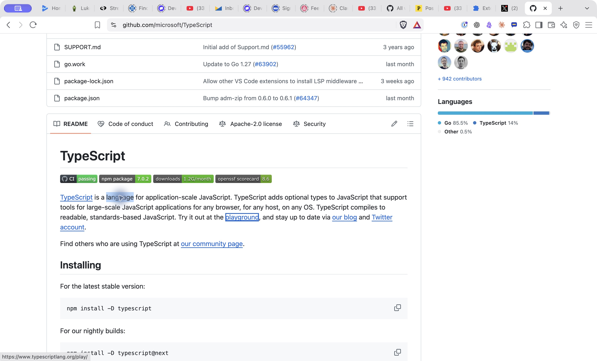
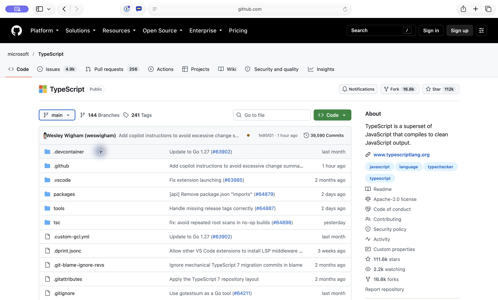
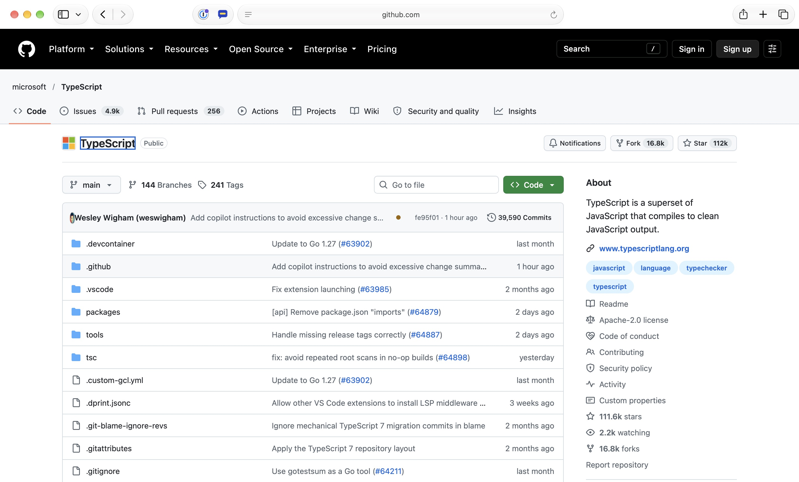
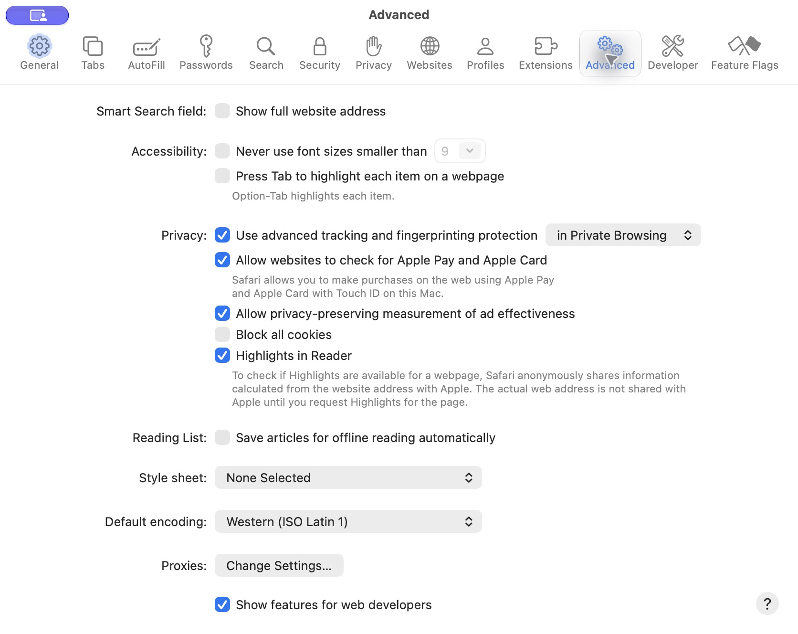

# Installed 0.0.8 — independent next-Tab retest

Subsequent installed-browser verification: [0.0.9 native keyboard retest — Safari and Brave requested forward checks pass](installed-extension-0.0.9-next-tab-2026-10-22.md). The 0.0.8 observations below remain historical evidence.

Date: 2026-10-22, America/Los_Angeles; local `date` checked. Scope: independently repeat the reported keyboard fix on the live GitHub TypeScript README. This is a focused runtime check, not a full code review or release approval.

Browser control was verified first: Brave's connected browser surface and native Brave/Safari apps were present. The owner reported reloading Curious in both browsers.

## Brave: pass

Native Extensions details displayed enabled **Be Curious 0.0.8**, ID `idhcldfokdopimdapmndnoimcoiodlgg`, loaded from this checkout's `prototypes/compact-window/extension` directory.

A fresh tab opened `https://github.com/microsoft/TypeScript`. Curious was activated using the toolbar. Find located “language for application”; Find was dismissed, then the actual word **language** in the README was double-clicked with the mouse. Each subsequent native keyboard action was followed by an accessibility observation:

1. Option+L opened the Curious card for language.
2. Escape removed the card and restored the selected word.
3. Tab focused the paragraph's **playground** link (`https://www.typescriptlang.org/play/`). The README remained at the same visible reading position; it did not jump to the repository header.

This is the previously failing forward-Tab path, exercised with native input. Shift+Tab and the rest of the regression suites were not rerun.

## Safari: jump to top still observed

Safari Settings → Extensions displayed **Curious 0.0.8**. Native inspection initially timed out, then recovered after the owner brought Safari forward.

On the same live README, double-clicking **language**, pressing Option+L, then Escape closed the card. Plain Tab then focused the **main branch** control and moved the page to the repository header (normalized scrollbar changed from approximately 0.586 to 0).

A second run used a native accessibility double-click on the paragraph. It selected **browser**, later in the same paragraph and still before the playground link. Option+L opened a card for browser; Escape removed it; **Option+Tab** then focused the repository's **TypeScript** title link at the top, again changing the scrollbar to 0. Coordinate clicks were failing at this point, so this second run is a documented variation of the exact language-word reproduction.

Read-only inspection of Safari Settings → Advanced confirmed **“Press Tab to highlight each item on a webpage” is unchecked**. Safari's own adjacent description says “Option-Tab highlights each item.” No preference was changed. Thus plain Tab alone cannot establish the expected link destination under this configuration, but the Option+Tab run also failed to preserve the reading position.

A baseline comparison without opening the card was attempted but native inspection timed out again before completion. These observations establish an unsuccessful installed Safari retest, not the underlying cause. The exact language/Escape/Option+Tab sequence and baseline comparison remain follow-ups.

## Verdict and boundary

**Brave passes the tested forward-Tab path. Safari does not pass: the jump to the top remains observable, including with Option+Tab in the same paragraph.** Investigate the installed Safari behavior before treating the cross-browser keyboard fix as verified. This focused check does not establish full 0.0.8 acceptance.

No source files were edited, and no commit or push was made. The existing 0.0.7 observations and Claude's 0.0.8 implementation notes remain intact.

## Fix in 0.0.9: Safari diagnosis and change (2026-10-22, not yet observed in installed Safari)

Both manifests are 0.0.9 (Chrome name stays "Be Curious"). Only `card.js` changed. It is byte-identical in the demo, `extension` and `safari-extension` (`cmp`), and `node --check` passes. Installed Safari was **not** re-tested. This section separates what was scripted in engines from what remains to be observed.

**What was available.** No control of the installed Safari. `safaridriver` could not create a session (remote automation is not enabled; it was not turned on), and no Safari setting was read or changed. Real WebKit was run instead: **Playwright WebKit 26.0** (build 2215, headless, macOS) in a scratch folder. This is the WebKit engine, not Safari 27.0.1. It runs no Safari Web Extension, so `card.js` is evaluated in the page rather than as a content script. It has no signed-in GitHub session, no Safari window and focus handling, and no AX inspection. Its default Tab behaves like Safari with "Press Tab to highlight each item" off: plain Tab skips links, and Option+Tab includes them.

**Native WebKit behavior (Curious never opened).** From probes on the fixtures and the live README:
- A double-click sets WebKit's Tab starting point at the click. After double-clicking "language" on live GitHub, plain Tab goes to the code block's copy button after the paragraph, and Option+Tab to "playground". Neither scrolls. This holds even though the click also focuses GitHub's `tabindex="0"` content pane.
- A selection alone does not set the starting point. With a selection restored by script and focus on `<body>`, Option+Tab goes to the first link on the page (jump to top).
- A focused `tabindex="-1"` element does set it, including after it is removed. A blurred one does not.
- In this build, `hidePopover()` leaves focus on the now-hidden button in the card, rather than restoring it.

So WebKit does continue natively from the double-clicked word. After Curious, the reading position survives only if focus is on something at the word.

**0.0.8 in WebKit.** In the plain flow (the card takes focus on Option+L, then Escape), 0.0.8 matches native on the fixtures and live GitHub. 0.0.8 fails in every case where focus is not in the card at Escape. `close()` then returned early. Nothing put focus back at the word, and the selection was not restored. On live GitHub this jumps to the header: plain Tab → "Platform", Option+Tab → "Skip to content". That is the same class of failure as installed Safari's "main branch" / repository-title jump. The exact target differs, plausibly because the owner's page is signed in.

**Cause (inferred, not observed in Safari 27).** Installed Safari's Option+Tab landed on the repository title, the first link inside GitHub's content pane. So focus, or the Tab starting point, ended on that pane or at the top of the page, not at the word. Two 0.0.8 paths produce that, and neither occurs in WebKit 26.0:
1. Focus is not in the card when Escape is handled, so `close()` returns early.
2. The browser hands focus back to the pane (the element focused when the card opened) after Curious focused the word. The HTML popover rules allow that when focus is still inside a popover as it hides.

**Change.**
- `close()` now moves focus out of the card *before* hiding it, so the popover hide has nothing to hand back.
- A keyboard close also returns to the words when focus is outside the card. This applies only when focus sits on `<body>` or the same plain container, and the reader hasn't clicked the page since opening.
- One animation frame later, if focus has been moved back to `<body>` or that container, the marker is placed again and the selection restored.
- Unchanged: a focused link or button that holds the words still gets focus back. Mouse Close still leaves selection and focus alone. A page click before Escape now explicitly leaves focus alone. The Escape order (enlarged image, then card) is unchanged.

**Scripted results** (Chrome 155.0.8059.85 headless with the extension test copy; WebKit 26.0 with `card.js` evaluated in the page). The WebKit harness compares every card result with native WebKit for the same key after the same double-click. It runs three modes: normal; focus never reaches the card; and something pulls focus back to the container right after close. The second and third simulate the inferred Safari differences.

| Suite | 0.0.7 | 0.0.8 | 0.0.9 |
| --- | --- | --- | --- |
| WebKit next-Tab vs native: fixtures + live GitHub, Tab / Option+Tab / Shift+Option+Tab, 3 modes, plus unchanged behaviors | 39/78 | 63/78 (all 15 failures in "focus never reaches the card") | **78/78** |
| Chrome next-Tab (0.0.8 suite plus the two simulated modes on the GitHub-like page) | 18/30 | 29/30 | **30/30** |
| Chrome 0.0.3 card / 0.0.4 images / 0.0.6 trail / accessibility | — | — | 15/15, 26/26, 27/27, 59/59 |

On live GitHub in WebKit 0.0.9, in all three modes: plain Tab → the code block copy button, Option+Tab → "playground", scroll unchanged at 1164, matching native. The live real-sites suite was not re-run. Harnesses are in the shared side-session notes folder (`nexttab-0.0.9-chrome-harness.js`, `nexttab-0.0.9-webkit-harness.js`, `webkit-focus-start-probe.js`), not in the repository.

**What this does not prove.** That installed Safari 27.0.1 now continues from the word. The simulated modes reproduce the observed class of failure, but which one (if either) happens in Safari was not observed. A Safari-only cause outside both, such as signed-in GitHub scripts acting on focus, would not be covered. The 0.0.8 section in the 0.0.7 report reasoned that Safari would pass. That was wrong in practice, and this section supersedes it. Its hand-check suggestion to turn on Safari's Tab highlighting is withdrawn: the owner keeps it off, and these steps don't need it.

**Owner hand check (installed Safari 27, then Brave, 0.0.9).** Reload the extension and confirm it reads 0.0.9. Leave "Press Tab to highlight each item" off. Use `https://github.com/microsoft/TypeScript`, the README sentence "TypeScript is a language for application-scale JavaScript", and note the scroll position each time.
1. **Baseline, Curious never opened.** Reload the page. Double-click "language", press Option+Tab. Expected native result: the "playground" link in that paragraph, no scroll. Reload, double-click "language", press plain Tab. Expected: the next button after the paragraph (the code block's copy button), no scroll. If either jumps to the top, Safari itself doesn't continue from the selection on this page; record that, and judge steps 2–3 against it.
2. **With Curious, Option+Tab.** Reload, turn Curious on, double-click "language", Option+L, Escape. "language" should be selected again with no scroll. Press Option+Tab: it should land where step 1's Option+Tab did.
3. **With Curious, plain Tab.** Repeat step 2 with plain Tab. It should land where step 1's plain Tab did.
4. Repeat steps 2–3 with "browser" in the same paragraph.
5. **If step 2 or 3 still jumps:** open Develop → Web Inspector on that tab (only if the Develop menu is already shown). Repeat up to Escape, then run `document.activeElement` in the console before pressing Tab. Report what it names. `SPAN` means the marker is in place and something else moves focus on Tab; `DIV#repos-split-pane-content` or `BODY` means focus was moved after Curious placed it.
6. **Brave:** repeat steps 2–3 (Tab includes links there by default; expected "playground", no scroll).
