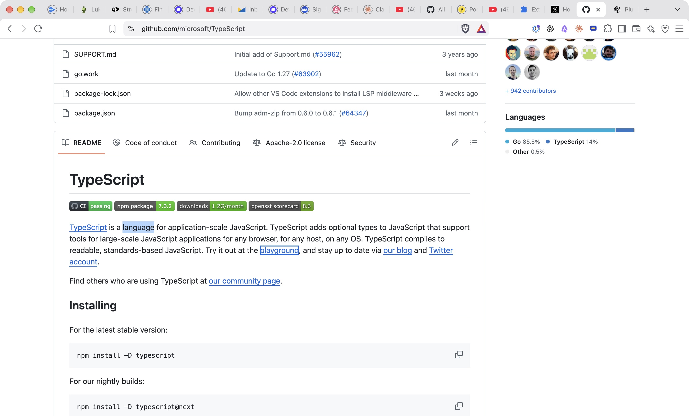
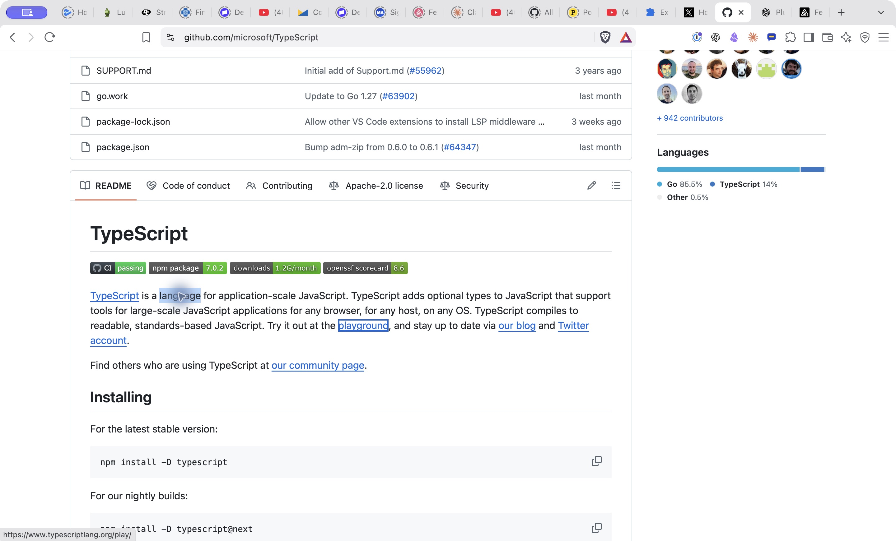
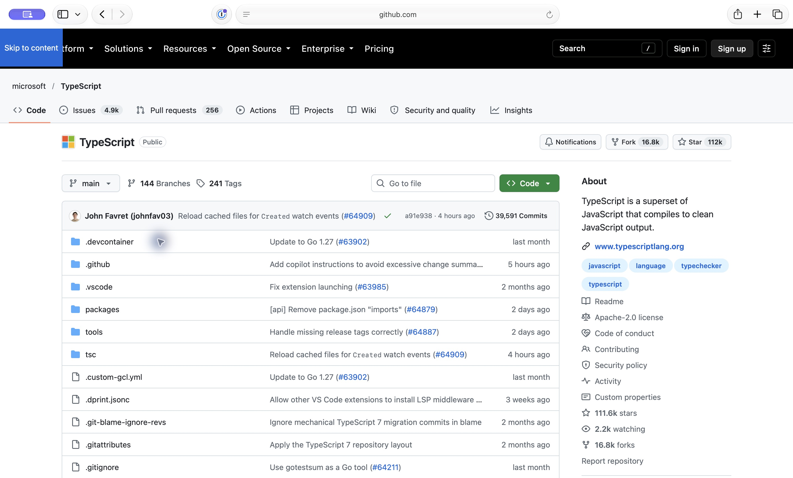
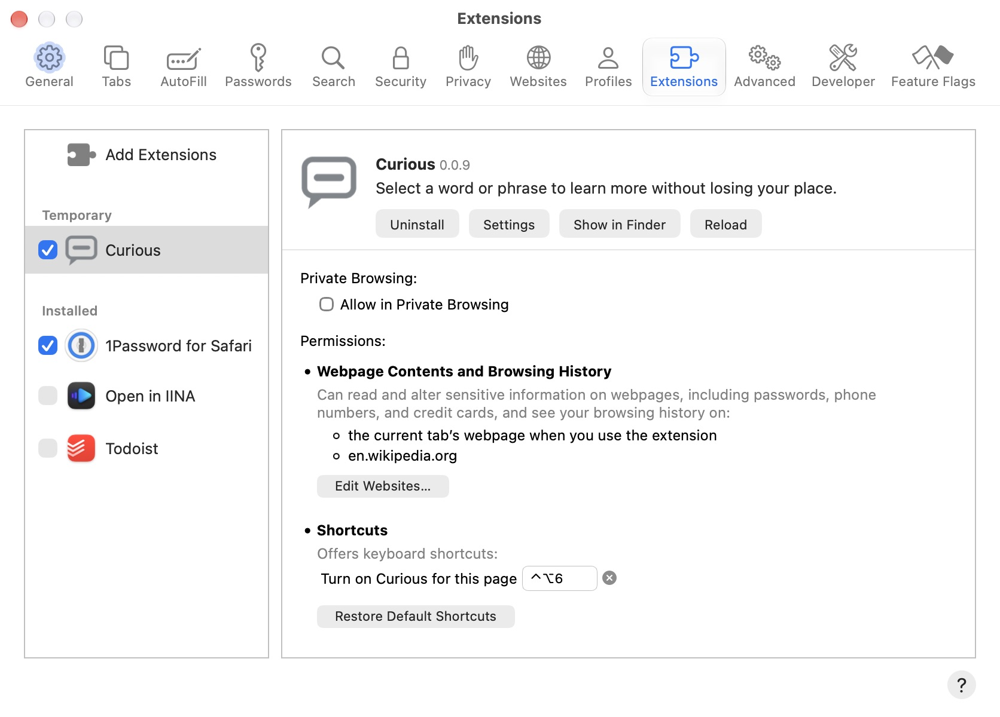

# Installed 0.0.9 — native keyboard retest

Date: 2026-10-22, America/Los_Angeles. Local date verified. This records installed-browser observations, separate from Claude's Chrome and Playwright WebKit results.

## Brave

The native extension details initially showed Be Curious 0.0.8. Clicking Reload changed the displayed version to **0.0.9**. The extension remains enabled, loaded from `prototypes/compact-window/extension` in this checkout.

On the live GitHub TypeScript README, Curious was activated after the reload. A native double-click selected **language**. Option+L opened a card whose search term was language; Escape removed it and restored the selection; plain Tab focused **playground**, with the reading position unchanged. **Pass.**

The initial Option+Tab attempt was interrupted by browser-control failure. After Safari testing completed, a fresh page reload and native language/Option+L/Escape/**Option+Tab** sequence also focused playground with the selection restored and no scroll. **Pass.**

## Safari — initial installation dependency

Native Safari control was available. Read-only Settings → Advanced inspection confirmed **Press Tab to highlight each item on a webpage is unchecked**, and the Develop menu is already visible. No keyboard preference was changed.

Settings → Extensions listed 1Password, Open in IINA, and Todoist, but **Curious was absent**, including from any Temporary section. The previously loaded temporary installation appears to have been removed. There was no Curious toolbar button to reload. The owner was asked to restore the temporary extension from `prototypes/compact-window/safari-extension` and confirm version 0.0.9.

Before a successful fresh reload, an existing content script could still display Learn more. With the card never opened, double-clicking language then Option+Tab focused playground without scrolling. This is a preliminary baseline observation with a stale content script, **not** a clean post-reload baseline and **not** evidence of 0.0.9.

A fresh page reload succeeded afterward, removing the stale Learn more control. The next baseline sequence was interrupted by user activity in Safari settings while the installation was being restored; no clean result was recorded. Native inspection also intermittently timed out. Automated Safari actions were paused for the owner's installation work.

## Safari — completed installed 0.0.9 retest

The owner restored the temporary extension. Independent Settings → Extensions inspection then displayed **Curious 0.0.9**, checkbox enabled. Advanced inspection again confirmed Tab highlighting **off**. Settings closed, inspection briefly stalled, then recovered; the README window was raised before sending native input. No browser preference was changed.

All cases below used the live `https://github.com/microsoft/TypeScript` README, native double-clicks on the actual word (not a script-created selection), and native keyboard input. Each case started with a fresh page reload. Find positioned the paragraph; Find was dismissed before double-clicking. Curious was off for both baselines, and activated using its toolbar button for each card case. Every card opened with the correct search term and focused Close card; Escape removed it and restored the selected word. Accessibility observations followed each key.

| Case | Key after selection / Escape | Observed destination | Scroll | Result |
| --- | --- | --- | --- | --- |
| Baseline, language, card never opened | Option+Tab | playground | unchanged | Pass |
| Baseline, language, card never opened | Tab | first code block Copy code to clipboard button | unchanged | Pass |
| Curious, language → Option+L → Escape | Option+Tab | playground | unchanged | Pass |
| Curious, language → Option+L → Escape | Tab | first code block Copy code to clipboard button | unchanged | Pass |
| Curious, browser → Option+L → Escape | Option+Tab | playground | unchanged | Pass |
| Curious, browser → Option+L → Escape | Tab | first code block Copy code to clipboard button | unchanged | Pass |

The README remained at the same visible paragraph and code blocks. Normalized scrollbar value was approximately **0.586331**; no tested flow returned to the repository header. The earlier Safari 0.0.8 failure was not reproduced in these installed 0.0.9 cases. Because no jump occurred, the conditional Web Inspector `document.activeElement` diagnostic was unnecessary and was not run.

Evidence:

- [Clean baseline Option+Tab](safari-0.0.9-clean-baseline-option-tab-2026-10-22.png)
- [Clean baseline Tab](safari-0.0.9-clean-baseline-tab-2026-10-22.png)
- [Language Option+Tab](safari-0.0.9-language-option-tab-2026-10-22.png)
- [Language Tab](safari-0.0.9-language-tab-2026-10-22.png)
- [Browser Option+Tab](safari-0.0.9-browser-option-tab-2026-10-22.png)
- [Browser Tab](safari-0.0.9-browser-tab-2026-10-22.png)

**Verdict: installed Safari 27's requested forward keyboard checks pass in 0.0.9, matching its native baselines. Brave's language checks also pass with Tab and Option+Tab.** This is a focused keyboard retest, not a full extension regression or release approval; Shift+Tab, images, positioning, Web/YouTube returns, and other prior checklist cases were not rerun for 0.0.9.

No source files were changed, and nothing was staged, committed, or pushed.
